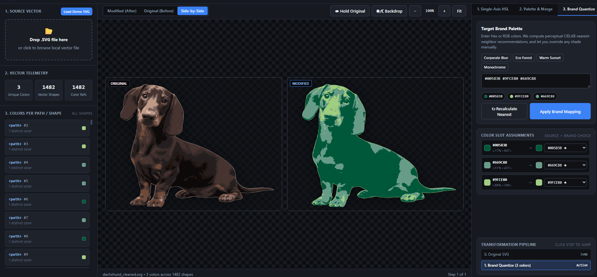

# svg-palette-pal
Scalable Vector Graphics need help sometimes. SVG Palette Pal provides basic palette transformations for quick graphics work.

## Sample

## Free for all:
* No account creation.
* No invasive ads.
* No user tracking.
* Permissive open license (GPLv3).

## Secure:
* Images never leave your computer, so you can transform them securely.
* App runs solely in your web-browser.
* I can't store your images, because the site never has you transmit them.
* Fully client-side processing.
* No backend server to copy or steal your IP.
* No AI processing or training on your content.